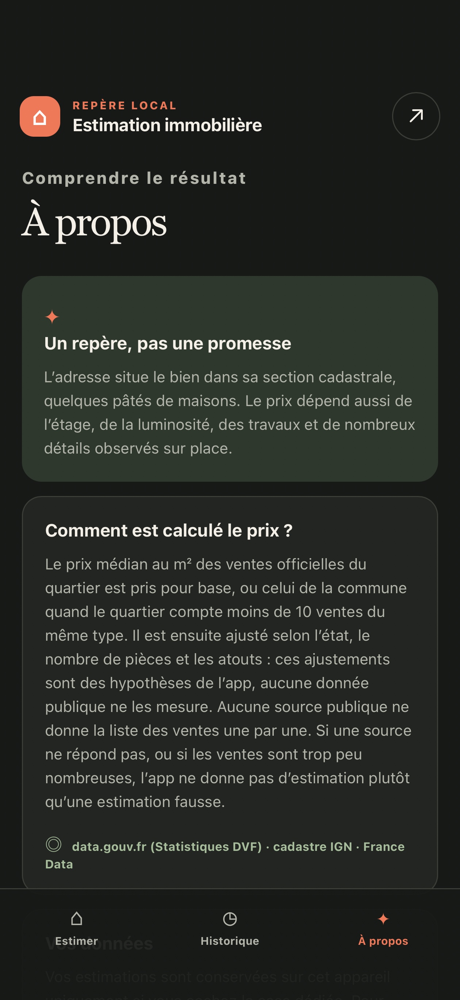
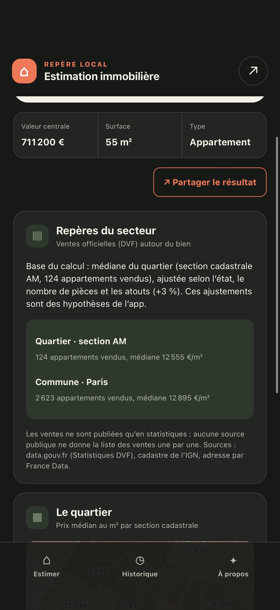
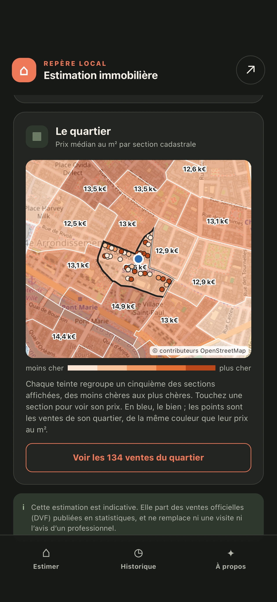
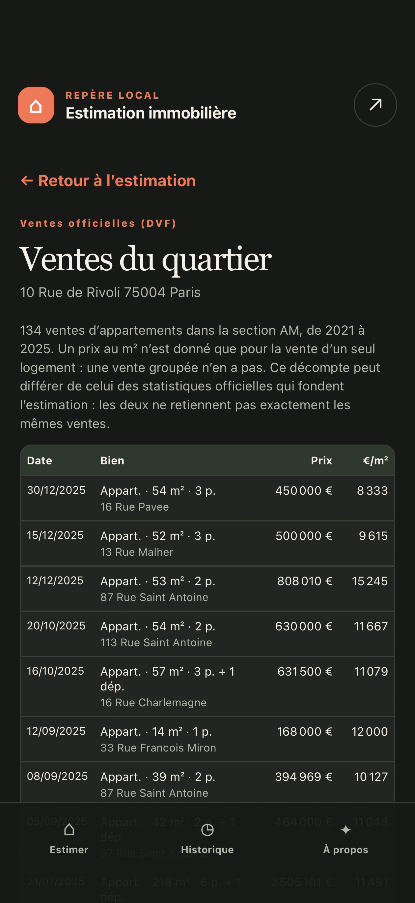

# Estimation immo

Évaluer indicativement le prix d’un bien situé en France à partir de son adresse, de ses caractéristiques et des ventes récentes de sa commune, puis retrouver localement les résultats complets enregistrés.

## Ce que cette app demande

- `share.present`

## Ce qu’elle peut contacter

- https://apicarto.ign.fr
- https://dvf-api.data.gouv.fr
- https://tile.openstreetmap.org

## Ce que c’est

Une page HTML, une feuille de style, un script, exécutés localement sur le
téléphone. Pas de dépendance, pas d’outil de construction.

Publiée par Olivier HO-A-CHUCK (@ohoachuck). Relue par personne d’autre.

Sous licence MIT — voir `LICENSE`.
